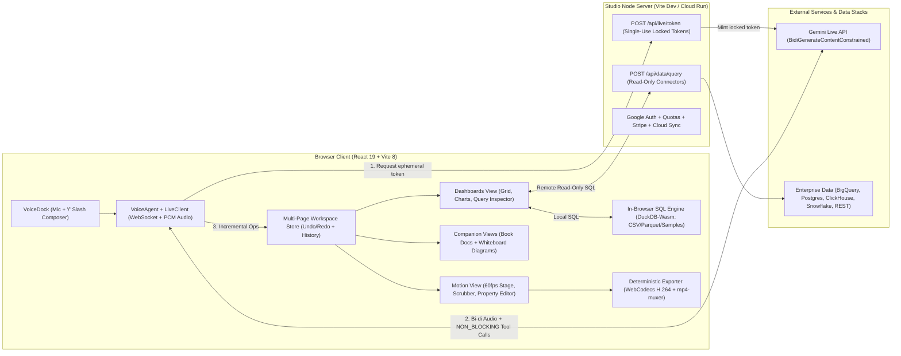

# Development Plan: Voice-to-Whiteboard — Live Dashboards & Motion Studio (Gemini Live)

This plan outlines the **feature set, technical architecture, repository setup, and phased development roadmap** for cloning [`speech_to_drawio`](file:///Users/radanpetrica/PFA/Projects/speech_to_drawio) into [`Voice-to-Whiteboard-App`](file:///Users/radanpetrica/PFA/Projects/Voice-to-Whiteboard-App) and evolving it into a **voice-first Live Dashboards & Programmatic Motion Studio** modeled after Claude's *Dashboards and Motion* workflow—powered end-to-end by the **Gemini Live API**.

> [!IMPORTANT]
> **Core Architectural Continuity:** Everything that makes [`speech_to_drawio`](file:///Users/radanpetrica/PFA/Projects/speech_to_drawio/README.md) fast, safe, and deterministic is preserved verbatim: browser-free API keys via single-use `fieldMask`-locked ephemeral tokens ([`liveToken.ts`](file:///Users/radanpetrica/PFA/Projects/speech_to_drawio/studio/server/liveToken.ts)), bidirectional Web Audio + barge-in ([`VoiceAgent`](file:///Users/radanpetrica/PFA/Projects/speech_to_drawio/studio/src/agent/session.ts#L53-L260)), versioned incremental edits on stable IDs with atomic Undo/Redo, and compact canvas state feedback on every `NON_BLOCKING` tool response.

---

## 1. System Architecture



---

## 2. Tech Stack Mapping (Inherited vs. New)

| Layer | Inherited from `speech_to_drawio` | Added / Modified for Dashboards & Motion |
| --- | --- | --- |
| **UI & Styling** | React 19, TypeScript 7, Vite 8, Material 3 dynamic palettes ([`theme.ts`](file:///Users/radanpetrica/PFA/Projects/speech_to_drawio/studio/src/ui/theme.ts)), `@material-symbols/svg-400`, `@fontsource/roboto` | Responsive 12-column Dashboard Bento Grid, SQL Inspector Drawer, Motion Stage + Multi-track Timeline Bar |
| **Voice & Agent** | [`LiveClient`](file:///Users/radanpetrica/PFA/Projects/speech_to_drawio/studio/src/voice/liveClient.ts), [`AudioIO`](file:///Users/radanpetrica/PFA/Projects/speech_to_drawio/studio/src/voice/audio.ts), [`liveSetup`](file:///Users/radanpetrica/PFA/Projects/speech_to_drawio/studio/src/voice/liveSetup.ts#L29-L59) (`gemini-3.8-live` / `thinking`), `Space` push-to-talk & `/` composer | Slash-command router (`/dashboard`, `/motion`, `/sql`, `/explain`, `/doc`) + new Dashboard & Motion `NON_BLOCKING` tool declarations |
| **Data & Charts** | `html-to-image` (PNG/SVG export) | **`@duckdb/duckdb-wasm`** (instant zero-setup local SQL over CSV/Parquet/JSON & sample datasets) + server-side read-only connectors (**BigQuery**, **Postgres**, **ClickHouse**, **REST**) + **ECharts** or **Recharts** bound to M3 theme tokens |
| **Motion & Video** | Deterministic scene model & React state store ([`store.ts`](file:///Users/radanpetrica/PFA/Projects/speech_to_drawio/studio/src/engine/store.ts)) | Pure TS **Keyframe & Spring Timeline Engine** (60fps SVG/Canvas2D scenes) + **WebCodecs `VideoEncoder` + `mp4-muxer`** for client-side `.mp4` export (`MediaRecorder` `.webm` fallback) |
| **Companion Views** | [`DocView.tsx`](file:///Users/radanpetrica/PFA/Projects/speech_to_drawio/studio/src/ui/DocView.tsx) (Book chapters & Markdown tables), `@xyflow/react` + `elkjs` canvas | Preserved as companion page modes so users can pair executive Docs & Whiteboard flows with Live Dashboards & Motion walkthroughs |
| **Security & Cloud** | [`liveTokenMiddleware`](file:///Users/radanpetrica/PFA/Projects/speech_to_drawio/studio/server/liveToken.ts#L153-L549), Keychain storage, Google OAuth, Firestore allowances, Stripe, Cloud Run | Server-held DB connector secrets, strict read-only SQL guardrails (`SELECT`/`WITH` AST validation, row/timeout caps), CSP updated for Wasm workers & `blob:` video playback |
| **QA & Evals** | Vitest (`test/`), Playwright mock Live WS (`e2e/`), real Gemini Live benchmark (`eval/`) | SQL guardrail & connector unit tests, Motion frame determinism tests, E2E dashboard/motion flows, multi-turn Live voice evals |

---

## 3. Feature Specification

### 3.1 Live Dashboards & Transparent Query Inspector

1. **Conversational NL-to-SQL & Dashboard Generation (Voice + Text)**
   - Speak or type natural-language analytical questions (e.g., *"Connect to the SaaS sample dataset and build an executive revenue dashboard: MRR KPI, net retention, quarterly revenue by region, and top 10 churn risks"*).
   - Gemini Live inspects available table schemas via `inspect_schema`, tests/validates queries via `run_query`, and populates the dashboard via `create_dashboard` or updates individual cards via `edit_dashboard`.

2. **Dual-Tier Data Connectivity**
   - **Local / Zero-Config Tier (In-Browser DuckDB-Wasm):**
     - Ships with **4 curated multi-table sample datasets** out of the box (*SaaS Metrics & Revenue*, *E-Commerce Orders & Funnel*, *Cloud FinOps & Infra Telemetry*, *Sales CRM Pipeline*) so the app works immediately after `./studio.sh` with zero external database setup.
     - Drag-and-drop local `.csv`, `.tsv`, `.json`, or `.parquet` files directly onto the studio to register instant SQL tables in the browser.
   - **Enterprise Server Connector Tier (`/api/data/*`):**
     - Pluggable read-only server adapters for **Google BigQuery** (ADC / Service Account), **PostgreSQL / Redshift**, **ClickHouse**, **Snowflake**, and **Salesforce / REST JSON** endpoints.
     - **Read-Only Safety:** Credentials never leave the Node server; every query passes a read-only verifier (rejecting DDL/DML/multi-statement mutations), enforces `LIMIT` caps (default 1,000 rows), and applies a 15-second execution timeout.

3. **Structured Dashboard Canvas & Incremental Voice Edits**
   - **Widget Catalog:**
     - `kpi`: Headline metric, formatted unit (`$`, `%`, compact), period-over-period delta badge, inline sparkline.
     - `line` / `area` / `bar` / `stacked_bar` / `horizontal_bar` / `pie` / `donut` / `scatter` / `funnel` / `heatmap`.
     - `table`: Sortable, formatted columns with conditional status badges/bars.
     - `filter`: Interactive dashboard-level parameters (`date_range`, `select`, `multi_select`) injected safely as named parameters (`:start_date`, `:region`) into bound widget queries.
   - **Incremental Mutations (`edit_dashboard`):**
     - Stable snake_case widget IDs (`kpi_mrr`, `chart_rev_region`) allow voice refinements like *"Switch the regional revenue chart to stacked bars by plan tier"* or *"Filter everything to Europe"* without regenerating untouched cards.
     - Drag-to-reorder and resize cards on a 12-column responsive grid; manual layout tweaks report back to Gemini Live in the next tool state summary.

4. **Anti-Hallucination & Auditability Inspector**
   - **Live Refresh & Provenance Badges:** Every widget header displays its data source badge, **exact last-refreshed timestamp** (e.g., `Refreshed 8s ago`), manual refresh trigger, and optional auto-polling interval (`Off`, `30s`, `1m`, `5m`).
   - **Click-Any-Number Query Inspector:** Clicking any KPI number, chart series/bar, or `</> SQL` badge opens the **Query & Lineage Inspector Drawer** displaying:
     - Exact SQL query executed + bound filter parameter values.
     - Source table/connector, row count, execution latency, and raw result table preview.
     - Editable SQL override (power users can tweak SQL by hand and re-run; Gemini sees the updated SQL!).
     - **"Ask Gemini Live to Explain" button:** Sends the widget's SQL and data slice into the active voice session so Gemini explains the metric logic, anomalies, or caveats aloud.

5. **Dashboard Exports & BI Handoffs**
   - Export full dashboard or single chart to **PNG / SVG**, **Standalone Interactive HTML**, **SQL + CSV Bundle (`.zip` / `.sql`)**, or **BI Handoff JSON** (Vega-Lite spec & Grafana dashboard model).

---

### 3.2 Programmatic Motion Studio (Code-Timeline Explainers)

1. **Deterministic Code-Driven Animation Engine (No Pixel Video Hallucination)**
   - Instead of black-box generative video pixels, Gemini authors and edits a structured, typed **Motion Composition AST** rendered deterministically at `30` or `60` fps:
     - **Aspect Ratios:** `16:9` (1920×1080 presentation/board deck), `9:16` (1080×1920 vertical/mobile), `1:1` (1080×1080 square).
     - **Scene Sequence (`scenes[]`):** Ordered beats with `id`, `title`, `durationMs`, background theme token, scene transition (`cut`, `fade`, `slide_left`, `slide_up`, `zoom_through`), and optional speaker/caption script.
     - **Animated Layer Primitives (`layers[]`):**
       - `kinetic_text`: Title, subtitle, bullet reveal, typewriter, word highlight, badge pill.
       - `metric_counter`: Smooth animated number roll-up (`0 → $4.2M`, `+28.4%`) optionally **live-bound** to a Dashboard KPI widget's real query result so numbers never drift or hallucinate.
       - `motion_chart`: Animated bar growth, line progressive draw, donut sweep, and timed `highlight_datum` callouts (e.g., pulsing spotlight + annotation arrow on Q3 EMEA spike).
       - `flow_diagram`: Animated node entrance and directional glowing edge pulses (reusing architecture/flowchart primitives from `speech_to_drawio`).
       - `callout_card` / `shape` / `image_asset`: Uploaded logos, screenshots, framing cards, arrows, and spotlight masks.
     - **Physics & Keyframes:** Declarative `enterAtMs`, `exitAtMs`, entrance/exit presets (`spring_pop`, `fade_up`, `slide_in`, `draw_stroke`, `counter_roll`), plus explicit property tracks (`opacity`, `x`, `y`, `scale`, `highlightIndex`).

2. **Cross-Surface One-Command Transformation**
   - Trigger via voice (*"Turn this revenue dashboard into a 25-second board walkthrough"*) or `/motion`:
     - Reads the active page's Dashboard widgets (real queried data), Documentation chapters, or Whiteboard diagram and synthesizes a multi-scene storyboard (Hook Title → Key KPI Roll-up → Chart Deep-Dive with Callout → Takeaway Summary) grounded 100% in actual workspace numbers.

3. **Interactive Timeline Scrubber & Direct Property Editing**
   - **Transport & Timeline Inspector:**
     - Play/Pause (`K`), frame-step (`←`/`→`), loop toggle, playback rate (`0.5×`, `1×`, `1.5×`, `2×`), current timecode (`00:08.15 / 00:24.00`), and clickable/draggable scene & layer timing bars.
   - **Document-Like Direct Editing + Voice Co-Editing:**
     - Click any text, number, color swatch, chart label, or scene duration directly on stage or in the right-hand **Inspector Panel** to edit inline—without touching raw code or re-prompting.
     - Conversational voice refinements via `edit_motion`: *"Make scene 2 two seconds longer"*, *"Change the opening headline to Q4 Growth Story"*, *"Highlight Enterprise ARR in emerald green"*.
     - All manual and voice edits share the same atomic Undo/Redo stack (`⌘Z` / `⇧⌘Z`).

4. **Client-Side MP4 Video Export**
   - Renders every frame deterministically (`t = frame / fps`) onto an offscreen high-DPI `<canvas>` and encodes H.264 video via browser **WebCodecs (`VideoEncoder`)** muxed in-memory with **`mp4-muxer`** into a downloadable `.mp4` file (with progress bar and automatic `.webm` fallback if WebCodecs H.264 is unavailable).

---

### 3.3 Unified Multi-Page Workspace & Gemini Live Tool Suite

Each page tab in [`Workspace`](file:///Users/radanpetrica/PFA/Projects/speech_to_drawio/studio/src/engine/workspace.ts#L76-L455) supports seamless view switching across **Dashboard**, **Motion**, **Documentation** (narrative report / metric dictionary), and **Whiteboard** (architecture & process diagrams):

| Tool Category | Gemini Live `NON_BLOCKING` Tools | Purpose |
| --- | --- | --- |
| **Data & SQL** | `list_data_sources`, `inspect_schema`, `run_query` | Discover local/connected tables, inspect columns & sample rows, validate read-only SQL before charting |
| **Dashboards** | `create_dashboard`, `edit_dashboard`, `refresh_dashboard`, `inspect_widget` | Build/modify dashboard widgets & filters by stable ID, refresh live data, open the SQL inspector on a card |
| **Motion** | `create_motion`, `edit_motion`, `control_motion` | Create multi-scene animated explainers (from prompt or active dashboard/doc/diagram), edit copy/timings/layers, play/pause/seek |
| **Docs & Whiteboard** | `write_text`, `write_table`, `create_diagram`, `edit_diagram`, `tidy_layout`, `search_catalog` | Inherited from `speech_to_drawio` for executive briefs, metric glossaries, and system/process whiteboarding |
| **Workspace** | `new_page`, `switch_page`, `rename_page`, `delete_page`, `change_view`, `undo`, `redo` | Multi-tab navigation (`view: "dashboard" \| "motion" \| "documentation" \| "diagram"`), spoken tab resolution, atomic undo/redo |

---

## 4. Repository Setup & Migration Plan

### 4.1 Copying & Cleaning `speech_to_drawio` into `Voice-to-Whiteboard-App`

1. **Scaffold Copy (preserving target `.git` & `LICENSE`):**
   - Copy [`studio/`](file:///Users/radanpetrica/PFA/Projects/speech_to_drawio/studio), [`studio.sh`](file:///Users/radanpetrica/PFA/Projects/speech_to_drawio/studio.sh), and `docs/` structure from `/Users/radanpetrica/PFA/Projects/speech_to_drawio` into `/Users/radanpetrica/PFA/Projects/Voice-to-Whiteboard-App`, **excluding**:
     - `.git/`, `studio/node_modules/`, `studio/dist/`, `studio/.env.local`, `studio/eval/results/*.json`, and old screenshot artifacts.
2. **Project & Keychain Configuration (`studio/package.json`, `studio/studio.sh`, `studio/server/apiKey.ts`):**
   - Rename package to `"voice-to-whiteboard-studio"`, update repository URL to `https://github.com/PetricaR/Voice-to-Whiteboard-App.git`.
   - Configure Keychain lookup in `apiKey.ts` and `studio.sh` to use service `"voice-whiteboard-studio"` while **automatically falling back** to reading `"voice-diagram-studio"` if already saved in macOS Keychain—so your existing Gemini API key works out-of-the-box with zero re-entry!
3. **Target Directory Layout:**

```text
Voice-to-Whiteboard-App/
  studio.sh                        # Top-level launcher wrapper
  README.md                        # Product docs, voice/slash commands & setup guide
  studio/
    studio.sh                      # Keychain, dev, check, test, e2e, eval, build CLI
    cloudrun.sh / Dockerfile       # Production Cloud Run container & IAM setup
    package.json                   # React 19, Vite 8, DuckDB-Wasm, Charting, mp4-muxer
    public/
      sample-data/                 # Built-in CSV/Parquet datasets (SaaS, E-Com, FinOps, CRM)
      gcp-icons/                   # Cloud architecture icons for Whiteboard/Motion flows
    server/
      index.ts                     # Prod HTTP server + updated CSP (Wasm + blob: media)
      liveToken.ts                 # Ephemeral token minting + /api/data/* mount
      dataConnectors.ts            # NEW: Read-only BigQuery, Postgres, ClickHouse, REST adapters
      sqlGuard.ts                  # NEW: Read-only SQL AST/statement validator & LIMIT enforcer
      apiKey.ts / auth.ts / usage.ts / stripe.ts / vitePlugin.ts
    src/
      data/                        # NEW: DuckDB-Wasm client, CSV/Parquet loader, unified QueryRunner
      engine/
        dashboard.ts               # NEW: Dashboard model, widgets, filters, incremental ops
        motion.ts                  # NEW: Motion composition AST, scenes, layers, keyframes, ops
        timeline.ts                # NEW: Pure frame evaluator (t -> deterministic scene state)
        workspace.ts               # UPDATED: Unified Page views (dashboard | motion | doc | diagram)
        scene.ts / book.ts / ops.ts / store.ts / summary.ts / resolve.ts
      motion-export/               # NEW: Canvas2D/SVG frame renderer + WebCodecs MP4 muxer
      agent/
        tools.ts                   # UPDATED: Dashboard, SQL, Motion + Doc/Diagram tool schemas
        dispatcher.ts              # UPDATED: Sequential execution + rich state summary feedback
        prompt.ts                  # UPDATED: Data analyst + motion director + architect persona
        session.ts / liveConfig.ts
      voice/                       # UNCHANGED: liveClient.ts, liveSetup.ts, audio.ts, liveToken.ts
      ui/
        dashboard/                 # NEW: DashboardView, WidgetCard, ChartRenderer, QueryInspectorDrawer, DataSourceModal
        motion/                    # NEW: MotionView, StageRenderer, TimelineScrubber, LayerPropertyEditor, ExportMp4Dialog
        canvas/ / DocView.tsx      # Companion Whiteboard & Book Documentation views
        VoiceDock.tsx              # UPDATED: Slash command menu (/dashboard, /motion, /sql, /explain)
        App.tsx / TopBar.tsx / PageTabs.tsx / SidePanel.tsx
    test/                          # Vitest: engine, sqlGuard, dashboard ops, motion timeline, auth/security
    e2e/                           # Playwright: UI smoke, mock Gemini Live dashboard+motion voice flows, MP4 export
    eval/                          # Real Gemini Live multi-turn benchmarks (NL2SQL accuracy, motion edits)
```

### 4.2 Environment & CLI Setup

```bash
# Local development (zero external DB required; uses built-in DuckDB-Wasm + Keychain Gemini key)
./studio.sh              # Installs deps, verifies/reuses Gemini API key, opens http://127.0.0.1:5173
./studio.sh key          # Set or rotate GEMINI_API_KEY in macOS Keychain
./studio.sh check        # End-to-end check: Keychain -> ephemeral token -> real Gemini Live session

# Optional Server Data Connectors (.env.local or Cloud Run env/Secret Manager)
BIGQUERY_PROJECT_ID=...              # Enables read-only BigQuery dataset querying via ADC
POSTGRES_READONLY_URL=...            # Enables read-only Postgres / Redshift connection
CLICKHOUSE_READONLY_URL=...          # Enables read-only ClickHouse HTTP connection
SNOWFLAKE_READONLY_CONFIG=...        # Optional Snowflake read-only connection

# Verification & Deployment
./studio.sh test         # Unit + SQL guard + token security tests (Vitest)
./studio.sh e2e          # Headless Chrome E2E (Dashboard + Motion + Mock Live WebSocket)
./studio.sh eval         # Multi-turn evaluation against real Gemini Live API
./cloudrun.sh deploy     # Deploy container to Google Cloud Run
```

> [!TIP]
> **Content-Security-Policy (CSP) Adjustments in `server/index.ts`:**
> To support in-browser SQL (DuckDB-Wasm Web Workers) and client-side MP4 preview/download without weakening script origin protections, `CONTENT_SECURITY_POLICY` will add `'wasm-unsafe-eval'` to `script-src` and `media-src 'self' blob: data:`.

---

## 5. Phased Development Roadmap

| Phase | Scope | Key Deliverables & Verification Gate |
| --- | --- | --- |
| **Phase 1: Repo Clone & Foundation Setup** | Copy `speech_to_drawio` into `Voice-to-Whiteboard-App`, rebrand metadata, configure Keychain fallback, add new npm packages (`@duckdb/duckdb-wasm`, chart library, `mp4-muxer`), update CSP, extend `Workspace` page views (`dashboard`, `motion`, `doc`, `diagram`). | `npm run typecheck`, `npm test`, and `./studio.sh check` pass cleanly. |
| **Phase 2: Data Engine & Read-Only Connectors** | Implement in-browser DuckDB-Wasm service + 4 sample datasets + CSV/Parquet drag-and-drop; implement server `/api/data/*` endpoints with `sqlGuard.ts` (`SELECT`/`WITH` validation, row caps, timeouts) and BigQuery / Postgres / REST read-only adapters. | Unit tests in `test/data.test.ts` verifying SQL injection/mutation blocking and sample dataset query execution. |
| **Phase 3: Live Dashboards & Query Inspector UI** | Build `engine/dashboard.ts` (typed widgets, filters, incremental ops, state summary), `DashboardView`, 12-col grid, M3 charts/KPIs, auto-refresh timestamps, **Query & Lineage Inspector Drawer** (click-any-number + SQL editor + *"Explain with Gemini"*), and HTML/PNG/SQL/Vega-Lite exports. | Unit tests for atomic dashboard edits & undo/redo; interactive UI rendering with sample + uploaded CSV data. |
| **Phase 4: Programmatic Motion Engine, Timeline & MP4 Export** | Build `engine/motion.ts` & `engine/timeline.ts` (scenes, kinetic text, live-bound metric counters, animated charts, flow pulses, spring physics), `MotionView` stage, `TimelineScrubber`, inline `LayerPropertyEditor`, cross-mode Dashboard→Motion generator, and WebCodecs + `mp4-muxer` `.mp4` exporter. | Frame-determinism unit tests + headless Chrome E2E verifying `.mp4` / `.webm` file generation. |
| **Phase 5: Gemini Live Agent Tools, Slash Commands & Prompt** | Wire all `NON_BLOCKING` Dashboard, SQL, and Motion tools in `agent/tools.ts` & `agent/dispatcher.ts`; add `/` slash commands (`/dashboard`, `/motion`, `/sql`, `/explain`) in `VoiceDock.tsx`; craft grounded system instructions in `agent/prompt.ts`. | Mock Live WebSocket E2E (`e2e/live-mock.mjs`) + real Gemini Live multi-turn eval suite (`./studio.sh eval`). |
| **Phase 6: Polish, Docs & Cloud Run Readiness** | Empty-state quick-start templates (*"SaaS Executive Dashboard"*, *"Animated Q3 Walkthrough"*), shareable `/s/:id` links for dashboards & motion compositions, updated `README.md`, `Dockerfile`, and `cloudrun.sh`. | Full `./studio.sh test && ./studio.sh e2e && npm run build` green. |
